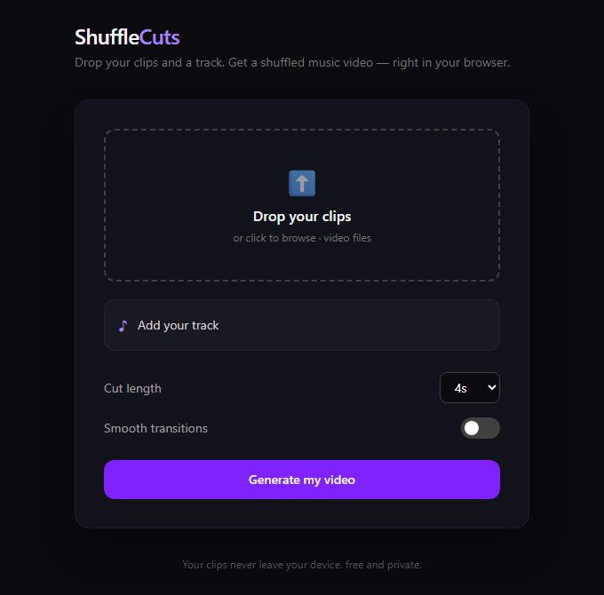

<p align="center">
  
</p>

<h1 align="center">ShuffleCuts</h1>

<p align="center">
  <b>Drop your clips and a song. Get a music video.</b><br>
  <a href="https://shufflecuts.vercel.app">shufflecuts.vercel.app</a>
</p>

---

Got a folder of clips from a trip, a party or a match, and a song you want them set to? ShuffleCuts cuts them into a music video that lasts exactly as long as the song. No editing timeline, no account, no upload.

## How to use it

1. **Drop your clips.** Any video files, as many as you like. Each one shows its length as soon as it lands.
2. **Add your track.** The song sets the length of the video, and ShuffleCuts looks up its timed lyrics. If it guesses the wrong song, tap "Wrong song?" and search by name.
3. **Pick a shape** (portrait, landscape or square; it starts on whatever most of your clips are), a cut length (2 to 10 seconds per shot) and whether you want smooth transitions and lyric captions.
4. **Generate.** A progress bar shows how long is left, and you can cancel any time. Watch it right away and download it.

## How it works

- **Every clip gets its turn.** Shots rotate through your clips in order, so no single clip takes over the video.
- **No repeats of the same moment.** Each clip keeps its own place and moves forward through its footage, and each one starts at a different point.
- **Every video lasts exactly as long as the song.** A clip shorter than the cut length plays whole and the next clip picks up the rest.
- **Shots fill the frame.** A portrait clip in a landscape video (or the other way round) sits over a soft blurred copy of itself instead of black bars.
- **Lyrics land on the beat.** Captions come from LRCLIB, an open lyrics database, and are only used when its timing matches your file's length, so every line shows up as it is sung. Only the song's title and artist are sent; the audio stays on your device.
- **It all happens on your device, fast.** ShuffleCuts uses your device's own video encoder through WebCodecs and reads clips straight from disk, so even big phone clips start in moments. Browsers without WebCodecs fall back to ffmpeg compiled for the web. Your clips never leave your computer or phone.

## Run it yourself

```bash
npm install
npm run dev
npm test
```

Built with React, TypeScript, Vite, Tailwind, Mediabunny (WebCodecs) and ffmpeg.wasm.

## Good to know

If a clip can't be read, it is marked in the list and left out, and the error names the file. Older browsers use the slower ffmpeg path, so long songs take longer there.
